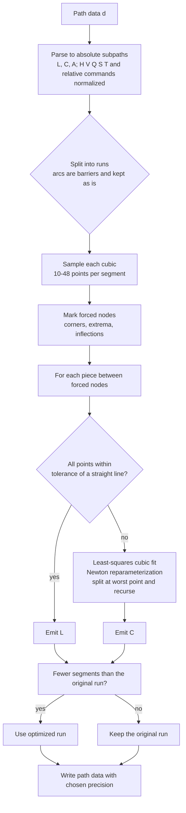
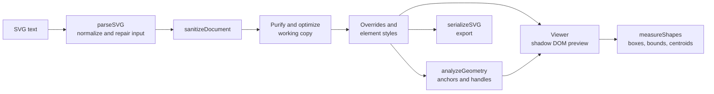

# SVG Area

**SVG Area** is a single-file, fully client-side vector workspace for converting, cleaning, previewing and inspecting SVG. Open `svg-area.html` in a browser and everything runs locally: no server, no build step, no uploads.

It has two complementary modes:

| Mode | Direction | Typical use |
| --- | --- | --- |
| **SVG to Code** | `.svg` file → clean, editable XML | Import a file from CorelDRAW, Illustrator, Inkscape, Figma and similar, purify it, simplify its nodes, then copy or download the result. |
| **Code to SVG** | pasted XML → live vector preview | Paste or type SVG code, see it instantly, repair broken markup, edit per-shape colors, optimize, and export. |

Both modes share the same preview engine, inspection overlays and optimizer.

---

## Table of contents

1. [Quick start](#quick-start)
2. [Feature overview](#feature-overview)
3. [Core concepts](#core-concepts)
4. [Feature reference](#feature-reference)
   - [Input and parsing](#input-and-parsing)
   - [Security and sanitization](#security-and-sanitization)
   - [Purify options](#purify-options-svg-to-code)
   - [Appearance overrides](#appearance-overrides-svg-to-code)
   - [Preview: zoom and pan](#preview-zoom-and-pan)
   - [Inspection overlays](#inspection-overlays)
   - [Geometry measurements](#geometry-measurements)
   - [Marker colors and size](#marker-colors-and-size)
   - [Element styles](#element-styles-code-to-svg)
   - [Node optimizer](#node-optimizer)
   - [Auto-repair](#auto-repair-code-to-svg)
   - [Export](#export)
5. [Keyboard and mouse reference](#keyboard-and-mouse-reference)
6. [Architecture](#architecture)
7. [Browser support](#browser-support)
8. [Privacy](#privacy)
9. [Limitations](#limitations)
10. [Development notes](#development-notes)
11. [Project layout](#project-layout)

---

## Quick start

1. Download or clone the repository.
2. Open `svg-area.html` in a modern browser (double-click it, or serve the folder with any static server).
3. Pick a tab:
   - **SVG to Code**: drop an `.svg` file on the drop zone, or use **Browse**.
   - **Code to SVG**: paste code into the editor, or press **Load sample**.

There is nothing to install. Two external resources are loaded from CDNs for cosmetics only: the **Manrope** and **DM Mono** fonts (Google Fonts) and the **Font Awesome 6** icon set (cdnjs). Without a connection the app still works; it falls back to system fonts and icons may be missing. To run fully offline, download those assets and point the `<link>` tags in the `<head>` to local copies.

---

## Feature overview

**Importing and parsing**
- Drag and drop, file browser (SVG to Code), or paste (Code to SVG).
- Forgiving parser: Markdown code fences, text around the `<svg>` block, legacy DOCTYPE entities and undeclared namespace prefixes are handled automatically.
- Readable error messages with line and column numbers.
- **Analyze & Repair** proposes fixes for broken XML and lets you review them before applying.

**Safety**
- Active content (scripts, event handlers, `foreignObject`, external references and more) is removed from the preview and from exports.
- The preview is rendered inside a Shadow DOM, so an SVG's own CSS and IDs can never affect the app.

**Preview**
- Native inline SVG (never rasterized), so every zoom level stays sharp.
- Zoom in and out, drag to pan, pinch on touch screens, fit to canvas, fit to shapes.

**Inspection overlays** (each one toggleable)
- Anchor points and subpath starts, Bézier control handles with their guide lines.
- Boundary box (tight box around all geometry), centroids (dot with an X) for every shape.
- Shape boxes (numbered), text boxes (`T1`, `T2`…) and bitmap boxes (`B1`, `B2`…), so you can tell vector shapes, editable text and embedded bitmaps apart.
- Fully customizable marker colors and marker size.

**Editing and cleanup**
- Purify: remove editor metadata, lock attributes, `data-*` attributes and empty groups.
- Global appearance overrides (stroke width, fill color) in SVG to Code.
- Per-element fill, stroke and stroke-width editing in Code to SVG, with an **Apply to code** action.
- **Node optimizer**: Bézier curve refitting that keeps corners, extrema and inflection points, with a built-in parameter guide.

**Output**
- Clean, indented XML with a version and UTF-8 declaration. Copy or download.

---

## Core concepts

### The coordinate space
Everything measured by the app (boundary box, centroids, tolerance) is expressed in the SVG's **user units**, the same coordinate system as the root `viewBox`. If a root `viewBox` is missing, it is derived from `width` and `height` (unit-aware: `px`, `pt`, `pc`, `mm`, `cm`, `in`; percentages are ignored and a default canvas is used). Nested transforms are accumulated per element and applied when measuring.

### Native vector preview
The preview does not draw to a canvas or convert to a bitmap. A cloned copy of your SVG is inserted as a real inline `<svg>` element, and zoom and pan are implemented by changing its `viewBox`. The browser re-renders the vector at the current scale, so detail stays crisp at any zoom.

### Shadow DOM isolation
Uploaded SVGs may contain `<style>` blocks (CorelDRAW and Illustrator exports almost always do) and `id` attributes that collide with the page or with the other tab. Rendering the preview inside a Shadow DOM guarantees that:
- an SVG's CSS cannot restyle the app,
- gradient, clip-path and filter IDs resolve inside the same preview only.

### Overlays are screen-constant
Inspection markers live in an overlay group inside the preview SVG. Their sizes are recomputed from the current zoom, so a node dot always looks the same size on screen, whether you are fully zoomed out or deep inside a curve. Strokes use `vector-effect: non-scaling-stroke`.

### Items: shapes, text and bitmaps
The app distinguishes three kinds of elements:

| Kind | Elements | Numbering |
| --- | --- | --- |
| **Shape** | `path`, `rect`, `circle`, `ellipse`, `line`, `polyline`, `polygon` | `1, 2, 3…` in document order |
| **Text** | `text` (live, editable text; outlined text is just paths) | `T1, T2…` |
| **Bitmap** | `image` | `B1, B2…` |

A compound path (one `<path>` with several subpaths, for example a letter with holes, or a union of shapes) counts as **one** item and gets **one** box. Elements inside `<defs>`, `<symbol>`, `<clipPath>`, `<mask>`, `<pattern>`, `<marker>` and similar are not drawn items and are skipped.

### Centroids
Each item gets a centroid marker: a dot with an X.

- **Area centroid** for closed shapes and filled shapes. The outline is flattened to a polygon and the area-weighted centroid is computed. Holes with opposite winding subtract correctly, so a ring's centroid stays at its center.
- **Line centroid** (length-weighted along the outline) for open, unfilled strokes such as a plain curve.
- **Point** for degenerate shapes with zero length.
- Text and bitmaps use the center of their bounding box.

### Boundary box
The boundary box is the smallest axis-aligned rectangle that touches the outermost edges of all measured geometry. Strokes are **not** included. It can be copied as a ready-to-use `viewBox` string. For axis-aligned transforms the browser's exact `getBBox()` is used; for rotated or skewed shapes the outline is sampled instead. Curves are sampled at 32 steps per segment and circles and ellipses at 128 points.

---

## Feature reference

### Input and parsing

**SVG to Code**
- Drop or browse for an `.svg` file. The file name, size and status are shown above the output.
- The original source is never modified. Purify, overrides and optimization are applied to a working copy.
- **Restore source** returns the working copy to the original source and switches purify and optimization off.

**Code to SVG**
- Live preview as you type (debounced).
- Buttons: **Format XML**, **Analyze & Repair**, **Load sample**, **Clear**.

**Parser behavior** (applies to both modes)
- Removes a surrounding Markdown code fence.
- Keeps only the `<svg>…</svg>` block when text surrounds it.
- Strips the DOCTYPE. Simple literal entities (such as the Adobe `&ns_svg;` family) are expanded; arbitrary DTD entities are deliberately not expanded, which prevents entity-bomb input.
- Converts common named character entities (`&nbsp;`, `&copy;`, `&mdash;`…).
- Auto-declares missing namespace prefixes (`xlink`, `inkscape`, `sodipodi`, `dc`, `cc`, `rdf`, `sketch`, `serif`, `i`, `x`, `svg`), a classic cause of "undefined prefix" parse errors.
- Adds the SVG namespace when it is missing and normalizes a prefixed root.
- Parse errors are reported as `Line X, column Y: message` where the browser provides them.
- Input size limit: 20,000,000 characters.

### Security and sanitization

Every SVG goes through a sanitizer before it reaches the preview or an export. It removes:

- Elements: `script`, `foreignObject`, `iframe`, `object`, `embed`, `applet`, `frame`, `frameset`, `link`, `meta`, `audio`, `video`, and SMIL animation (`animate`, `animateMotion`, `animateTransform`, `set`).
- Attributes: all `on*` event handlers, `xml:base`, and any value containing `javascript:`, `vbscript:` or `expression(`.
- References: only same-document references (`#id`) and base64 raster data URIs (PNG, JPEG, GIF, WebP) are allowed. External URLs in `href`, `xlink:href` and `url(...)` are removed.
- CSS: `@import` rules and `expression(...)` in `<style>` elements.

The number of removed items is shown in the preview note.

### Purify options (SVG to Code)

Purification is applied when you press **Apply purification** and is fully reversible with **Restore**.

| Option | What it does |
| --- | --- |
| **Remove app metadata** | Drops `metadata`, `namedview`, comments, foreign-namespace elements (for example `sodipodi:namedview`, `rdf:RDF`, `i:pgf`), unused `xmlns:*` declarations and empty `<defs>`. |
| **Remove lock attributes** | Strips protection flags (attribute names containing `lock`, `protect`, `readonly`, `prevent-edit`) and editor-specific attributes (Inkscape, Sodipodi, Adobe Illustrator, CorelDRAW `xodm`, Sketch, Figma and similar). |
| **Remove data attributes** | Clears custom `data-*` attributes. |
| **Remove empty groups** | Deletes `<g>` containers that became empty. |

### Appearance overrides (SVG to Code)

Live, non-destructive overrides on the working copy. Each is an opt-in checkbox; its control appears only after you tick it.

- **Override stroke width**: sets a consistent stroke width (1–10 px) on drawable elements.
- **Override fill color**: recolors filled shapes while preserving elements explicitly set to `fill="none"`, so stroke-only paths stay stroke-only.

### Preview: zoom and pan

A toolbar sits at the top-right of the preview:

| Button | Action |
| --- | --- |
| − / + | Zoom out / in around the center |
| Zoom level | Current zoom relative to the fitted canvas |
| Expand icon | Fit to the canvas (`viewBox`) |
| Crosshair icon | Fit to the measured shapes (with a margin) |

Zoom range is 2% to 5000% of the fitted view. A dashed frame shows the original canvas bounds. Content outside the `viewBox` stays visible, so you can see what an export would clip.

### Inspection overlays

Toggles above the preview. A legend below the preview mirrors the colors.

| Overlay | Meaning |
| --- | --- |
| **Anchor points** | Path endpoints; subpath starts are drawn larger and in a separate color. |
| **Bézier handles** | Control points plus dashed guide lines to their anchors (cubic and quadratic). |
| **Boundary box** | Tight box around all geometry. |
| **Centroids** | A dot with an X on every shape, text and bitmap. |
| **Shape boxes** | A numbered box per shape (compound paths are one box). |
| **Text** | Dotted boxes labelled `T1…`, for live `<text>` elements. |
| **Bitmaps** | Dashed boxes labelled `B1…`, for `<image>` elements. |

Details:
- Anchors and handles come from a full path parser that supports all commands (`M L H V C S Q T A Z`, absolute and relative), compact number forms and glued arc flags such as `a5 5 0 1010 0`.
- For performance, at most **6,000** anchors and **6,000** handles are drawn; a notice appears when the cap is hit. Use the optimizer to reduce very dense paths.
- Hovering a row in **Element styles** highlights that shape's box in the preview.

### Geometry measurements

A collapsible panel under the preview (closed by default). It shows, depending on which overlays are enabled:

- the item counts (shapes split into paths and native shapes, text, bitmaps),
- the boundary box (`x`, `y`, `w`, `h`) with a **viewBox** button that copies the tight `viewBox`,
- a list of centroids with their coordinates and calculation mode (`area`, `line` or `point`),
- a list of text elements (with a snippet of their content) and bitmaps (embedded or linked, with box size).

Strokes are excluded from all measurements.

### Marker colors and size

A collapsible **Marker colors & size** section under the legend, available in both tabs. You can set the color of anchors, subpath starts, handles, handle lines, boundary box, centroids, shape boxes, text boxes, bitmap boxes and the marker outline, plus a marker size from 50% to 250%. Use this when the default colors blend into your artwork, for example switch the marker outline to white on a dark drawing. **Reset colors** restores the defaults. The legend updates live.

### Element styles (Code to SVG)

A collapsible **Element styles** section lists every detected shape with its index and tag (and `id` if present). The number matches the numbered shape boxes in the preview.

- Each row has three opt-in checkboxes: **Fill**, **Stroke** and **Stroke width**. The matching control (color picker with a *none* option, or a number field) appears only after you tick the checkbox. Unticking removes the override.
- Changes show immediately in the preview and are included in exports.
- **Apply to code** writes the overrides into the editor (the previous code is kept for **Undo**).
- **Reset all** clears every override; each row also has its own reset button.
- Up to 300 rows are listed for very large documents.
- Overrides are tied to the current document structure. If the set of shapes changes, the overrides are cleared.

### Node optimizer

The optimizer reduces the number of nodes (segments) in a path while keeping its shape within a tolerance. It is available in both tabs (an info button next to the title opens a full parameter guide):

- **SVG to Code**: tick *Enable path optimization*. The preview, node counts and generated XML use the optimized working copy. The original is untouched.
- **Code to SVG**: press **Optimize code**. The optimized markup replaces the editor content; **Undo** restores the previous version.

A result line reports nodes before and after, shapes changed, and path-data size.

**Parameters**

| Parameter | Range / default | Effect |
| --- | --- | --- |
| **Tolerance** | 0.01–1.00% of the canvas diagonal, default 0.10% | Maximum allowed deviation. Higher = fewer nodes but less detail. |
| **Corner angle** | 5–90°, default 30° | Joins sharper than this are corners and always kept. |
| **Keep extrema nodes** | on | Keeps nodes at horizontal and vertical extremes. |
| **Keep inflection points** | on | Keeps nodes where a curve changes its bend direction. |
| **Simplify polylines** | on | Thins `polyline` and `polygon` points (Douglas–Peucker). |
| **Purify while optimizing** | on | Cleans headers, metadata, locks and single-element groups. |
| **Decimal precision** | 1–6, default 3 | Decimals written for every coordinate. |

**Presets (guidance)**

| Preset | Settings | Use |
| --- | --- | --- |
| Light cleanup | Tolerance 0.03%, corner 25°, extrema and inflection on, 3 decimals | Near-lossless cleanup of over-segmented or auto-traced paths. |
| Balanced | Tolerance 0.10%, corner 30°, extrema and inflection on, 3 decimals | Default; good reduction with no visible change. |
| Aggressive | Tolerance 0.30–0.50%, corner 45°, extrema and inflection off, 2 decimals | Smallest files for web graphics; check details afterwards. |

**How it works**



1. **Normalize.** Path data is parsed into absolute `L`, `C` and `A` segments. Quadratic curves are elevated to cubics exactly; `H`, `V`, `S`, `T` and relative commands are resolved. Compact number forms and glued arc flags are handled.
2. **Sample and classify.** Each cubic is sampled densely, plus exact extremum and inflection parameters found by solving the derivative equations. At every join, the tangent turn angle decides whether it is a corner. Extrema (direction reversal or an axis-aligned tangent) and inflections (bend sign flips) are marked when those options are on.
3. **Fit.** Between forced nodes, points are fitted with Schneider-style least-squares cubic Béziers. If the error exceeds the tolerance, the curve is reparameterized with Newton–Raphson and, if necessary, split at the worst-fitting point and fitted recursively. Pieces within tolerance of a straight line become plain `L` segments.
4. **Safety net.** A run is only replaced when the result has fewer segments than the original. Closed subpaths keep their start node, and a final redundant line back to the start is dropped because `Z` already draws it.
5. **Tolerance in local space.** The tolerance is converted to each element's local coordinates using its accumulated transform scale.

**Purify while optimizing** (on by default, both tabs)

- Removes comments, `metadata`, foreign-namespace elements (CorelDRAW, Illustrator, Inkscape…), lock and protection attributes, unused namespace declarations and empty `<defs>`.
- Unwraps a `<g>` that contains exactly one element. Its `transform` is merged into the child, and inheritable presentation attributes (`fill`, `stroke`, `stroke-width`, caps, joins, dashes, opacities, rules) and `opacity` are moved onto it when the child does not set them. Groups with `class`, `style`, `clip-path`, `mask` or `filter`, or whose `id` is referenced by `use`, `url(#…)` or CSS, are left alone.
- Keeps the root `version` attribute and the XML version of the original declaration. The file is always written as UTF-8, so the declaration says `UTF-8`.
- `data-*` attributes are left untouched here (use the Purify options for that).

### Auto-repair (Code to SVG)

**Analyze & Repair** inspects the markup and opens a review panel with a numbered list of proposed changes and a side-by-side view of the original and the proposed result. Nothing changes until you apply it. Repairs include:

- removing a Markdown fence or text outside the `<svg>` block,
- removing or simplifying the DOCTYPE,
- declaring missing namespace prefixes and fixing the root `xmlns`,
- quoting unquoted attribute values,
- escaping bare ampersands and converting legacy entities,
- inserting missing closing tags, removing unmatched closing tags, self-closing leaf elements,
- closing unfinished comments, CDATA sections, processing instructions and attribute quotes at the end of input.

If the input cannot be repaired safely, the panel says so instead of guessing.

### Export

- **SVG to Code**: the **Generated SVG XML** panel (collapsible) shows the result, with **Copy code** and **Download SVG**.
- **Code to SVG**: **Export SVG** downloads the safe, sanitized SVG, including any element-style overrides.
- Output is indented XML starting with `<?xml version="…" encoding="UTF-8"?>`. The XML version comes from the source declaration (`1.0` or `1.1`; defaults to `1.0`).
- The sanitizer's removals are reflected in exports. The preview and the export always match.

---

## Keyboard and mouse reference

| Input | Action |
| --- | --- |
| Mouse wheel over the preview | Zoom at the cursor |
| `Ctrl` + wheel / trackpad pinch | Faster zoom |
| Drag | Pan |
| Two-finger pinch (touch) | Zoom and pan |
| Double-click | Fit to canvas |
| `+` / `=`, `-` | Zoom in / out (preview focused) |
| `0` | Fit to canvas (preview focused) |
| Arrow keys | Pan (preview focused) |
| `Esc` | Close the optimizer info dialog |

Because the wheel is used for zooming, scroll the page with the scrollbar or by hovering outside the preview.

---

## Architecture

The whole app lives in one HTML file with three parts: markup, CSS, and one inline script wrapped in an IIFE. There are no dependencies and no build.



**Logical modules** (all inside the script)

| Module | Responsibility | Key functions |
| --- | --- | --- |
| Input and parsing | Normalize text, build the XML document, report errors | `normalizeSvgInput`, `extractSvgBlock`, `stripDoctype`, `addMissingPrefixes`, `parseSVG`, `getXmlParserError` |
| Safety | Remove active content and unsafe references | `sanitizeDocument`, `safeReference` |
| Cleanup | Purification, overrides, unwrap, namespace pruning | `applyPurification`, `applyOverrides`, `unwrapSingleGroups`, `dropUnusedNamespaces` |
| Serialization | Pretty XML output with declaration | `prettyElement`, `serializeSVG` |
| Geometry | Transforms and path parsing and flattening | `parseTransform`, `elementMatrix`, `scanPath`, `flattenPath`, `arcPoints`, `pathGeometry`, `analyzeGeometry` |
| Measurement | Bounds, centroids, item classification | `shapeSubpaths`, `centroidOf`, `measureShapes` |
| Viewer | Shadow DOM preview, zoom and pan, overlays | `createViewer`, `makePreview`, `markerPrefs` |
| Optimizer | Curve fitting and simplification | `absoluteSubpaths`, `optimizeRun`, `fitCubic`, `genBez`, `optimizePathData`, `rdp`, `optimizeDocument` |
| Element styles | Per-shape fill and stroke overrides | `shapeEls`, `applyElementStyles`, `buildElementList` |
| Repair | Detect and propose XML fixes | `repairSvgMarkup`, `repairTagStructure`, `repairBareEntities`, `showRepairProposal` |

**State.** A single `state` object keeps the loaded source, the working documents, element-style overrides and undo information. Each tab owns one viewer instance, keyed `to-code` or `to-svg`, which keeps its own zoom and pan between re-renders and resets them when the canvas changes.

---

## Browser support

A current evergreen browser is required: Chrome, Edge, Firefox or Safari (recent versions). The app relies on Shadow DOM, `ResizeObserver`, Pointer Events, the `<dialog>` element, `DOMParser` with `image/svg+xml`, and modern JavaScript and CSS (optional chaining, `inset`, `:scope`).

---

## Privacy

SVG Area never uploads your files. All parsing, sanitizing, measuring and optimizing happens in your browser tab. The only network requests are the font and icon CDN links described in [Quick start](#quick-start).

---

## Limitations

- **Arcs are not simplified.** `A` commands are kept as they are (precision rounding aside).
- **Optimizer scope.** Only `path`, `polyline` and `polygon` are optimized. `rect`, `circle`, `ellipse`, `line`, text and images are left alone.
- **Measurements ignore strokes**, filters, markers, clipping and masks. Nested `<svg>` viewports and `<use>` instance transforms are only partially accounted for; a `<use>` is measured by its bounding box.
- **Text boxes** use the browser's layout, so a hidden tab may need a moment to measure; the app re-measures when the tab becomes visible.
- **Group unwrapping is conservative.** Groups carrying `class`, `style`, `clip-path`, `mask` or `filter` are never unwrapped.
- **External resources are removed.** Linked images and external references are blocked by design.
- **Dense files.** Overlay markers are capped at 6,000 per type; the Element styles list at 300 rows.
- **UTF-16 sources** are read normally but always exported as UTF-8.

---

## Development notes

- Edit `svg-area.html` directly; reload the page to test. A simple local server (`python3 -m http.server`) is enough if you prefer `http://` over `file://`.
- Overlay and viewer code is written against the document DOM, but the geometry helpers (`scanPath`, `flattenPath`, `arcPoints`, `centroidOf`, `optimizePathData`, `fitCubic`, `rdp`) are plain functions and can be copied into a Node script for quick numeric tests. Useful sanity checks:
  - a 120-segment polygon approximating a circle should reduce to about 4 cubic segments,
  - an already optimal four-cubic circle should stay unchanged,
  - a square's centroid is its center, and a ring's centroid stays at the center despite the hole.
- When adding a new overlay toggle, add a `show-<name>-<tab>` checkbox in both panes, include it in the viewer's `change` listener list, draw it in `drawOverlay`, and (if it has a color) add it to `MK_DEFAULTS` and `MK_LABELS`.
- Keep user-facing text in English.

---

## Project layout

```
.
├── svg-area.html   # the entire application (markup, styles, script)
├── README.md       # this document
└── .gitignore
```

---

## License

No license has been chosen yet. Add a `LICENSE` file before publishing or accepting contributions.
